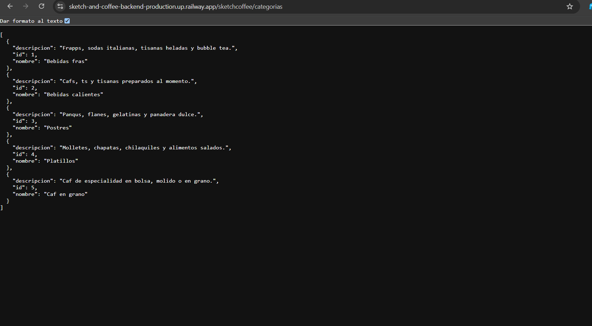
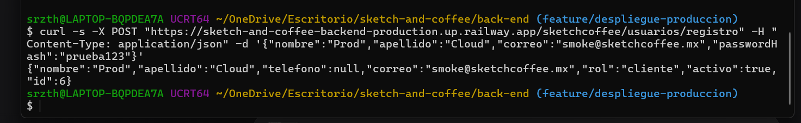

# Despliegue a Producción - Sketch & Coffee

## URL Pública del API
La API se encuentra desplegada y activa en:
**https://sketch-and-coffee-backend-production.up.railway.app/sketchcoffee**

## Variables de Entorno Configuradas en Railway
* `SPRING_DATASOURCE_URL`: jdbc:mysql://${{MySQL.MYSQLHOST}}:${{MySQL.MYSQLPORT}}/sketch_coffee
* `SPRING_DATASOURCE_USERNAME`: ${{MySQL.MYSQLUSER}}
* `SPRING_DATASOURCE_PASSWORD`: ${{MySQL.MYSQLPASSWORD}}
* `SPRING_JPA_DATABASE_PLATFORM`: org.hibernate.dialect.MySQLDialect

## Resumen de Pasos Realizados
1. Creación del proyecto en Railway y servicio MySQL.
2. Migración de las 5 tablas ejecutando el script ajustado (sin DROP/CREATE DATABASE) en la base de datos `sketch_coffee`.
3. Configuración de la aplicación en Railway conectada al repositorio de GitHub (rama `feature/despliegue-produccion`).
4. Generación del dominio público apuntando al puerto 8080.

## Smoke Tests Documentados
1. **GET Categorías:** `https://sketch-and-coffee-backend-production.up.railway.app/sketchcoffee/categorias` -> Status 200, 5 categorías devueltas.

2. **POST Registro:** Se creó el usuario `smoke@sketchcoffee.mx` exitosamente con rol `cliente`.

